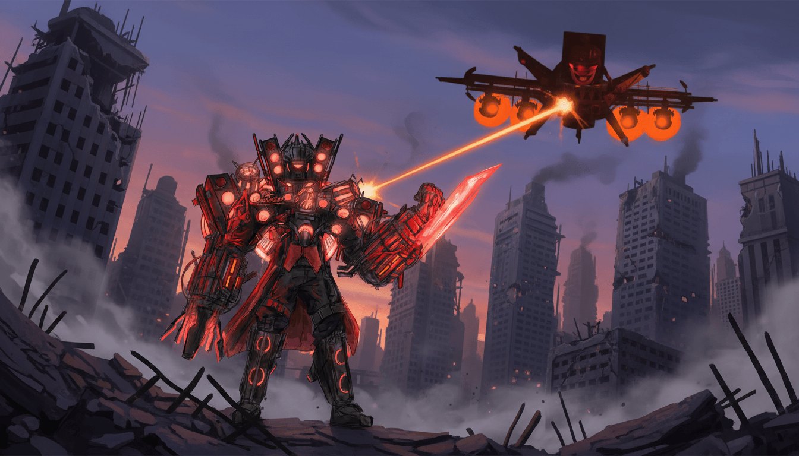

# 🔊 Titan Speakerman

> **"I don't just debug code — I blast it out of existence."**

Titan Speakerman is an AI & Software Engineer currently working at **[+4M](https://github.com/LoBot-LLC)** — the loudest, bass-heavy, speaker-headed force in the alliance. Originally from the [Skibidi Toilet Universe](https://skibidi-toilet.fandom.com/wiki/Titan_Speakerman), he traded the battlefield for the terminal and now brings sonic justice to bad software everywhere.

Famous for having **mega speakers on his head** and for **lovin' to kick Astro Toilets' butts**, Titan Speakerman doesn't write clean code — he *amplifies* it.

  
   
  <em>Mega speakers engaged. Astro Toilet detection: active.</em>

---

## 🎧 Theme Songs

When Titan Speakerman boots up, he doesn't play lo-fi. He plays:

- **[Everybody Wants to Rule the World — Tears for Fears](https://en.wikipedia.org/wiki/Everybody_Wants_to_Rule_the_World)**  
  Because world domination starts with a clean `git push`.
- **[The Uncanny Valley — Perturbator](https://perturbator.bandcamp.com/album/the-uncanny-valley)**  
  For those late-night debug sessions where the stack traces look… *almost* human.

---

## 🛠️ Tech Stack

Titan Speakerman's build is stacked louder than his speaker array:

<table>
  <tr>
    <td><b>Package Manager</b></td>
    <td><b>Runtime</b></td>
    <td><b>Language</b></td>
    <td><b>Framework</b></td>
    <td><b>Styling</b></td>
  </tr>
  <tr>
    <td>
      
       <b>npm</b>
    </td>
    <td>
      
       <b>NodeJS</b>
    </td>
    <td>
      
       <b>TypeScript</b>
    </td>
    <td>
      
       <b>NextJS</b>
    </td>
    <td>
      
       <b>Tailwind CSS</b>  <b>CSS</b>
    </td>
  </tr>
  <tr>
    <td colspan="5" align="center">
      <b>Bun</b> — 
    </td>
  </tr>
</table>

### 🔌 MCP Servers

| MCP | Purpose |
|-----|---------|
| **Playwright** | Browser automation so thorough it could kick an Astro Toilet's butt across the DOM |
| **Reverse Engineer Anything (REA)** | Because sometimes you just need to see how the enemy's speakers are wired |

---

## 🚀 Main Project

Titan Speakerman's flagship operation — **[TecnoIndicator](https://github.com/LoBot-LLC/TecnoIndicator)** — the indicator so tecno it practically has its own speaker array.

---

## 💥 Combat Record

| Enemy | Status | Method |
|-------|--------|--------|
| Astro Toilets | 🟢 Defeated | Mega-speaker butt-kicking |
| Buggy production deploys | 🟢 Neutralized | `bun run deploy` + bass drop |
| Spaghetti code | 🟢 Refactored | TypeScript strict mode |
| Legacy CSS | 🟢 Obliterated | Tailwind utility classes |

---

## 📜 License

MIT — Because even a Titan needs to share the speaker glory.

---

  <b>Built with 🔊, ⚡, and a questionable amount of bass by Titan Speakerman @ LoBot-LLC</b>
   
  <i>"Everybody wants to rule the world… but I just want to fix this merge conflict."</i>

